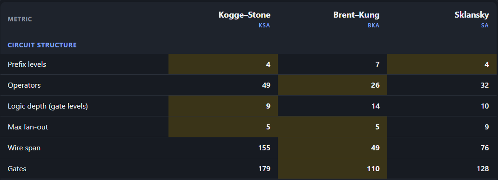
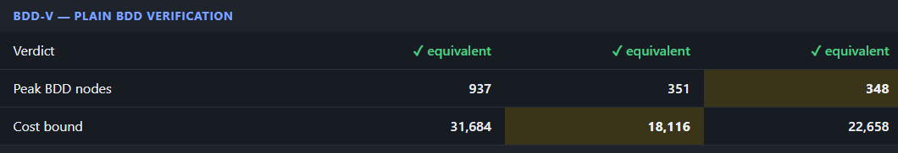
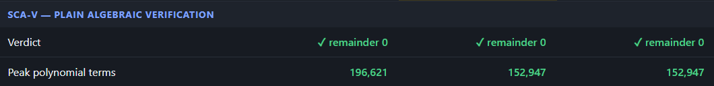
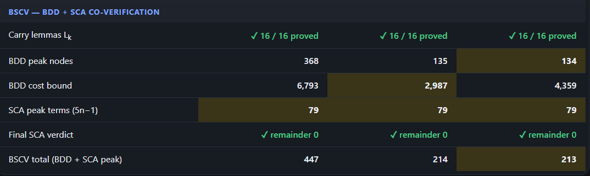

Polynomial Formal Verification of Parallel Prefix Adders

BDD–SCA co-verification of 16-bit **Kogge–Stone (KSA)**, **Brent–Kung (BKA)** and **Sklansky (SA)** adders, built on CUDD.

**Idea:** cut the adder at `g` and `p`, prove every carry with BDDs (`c_k ≡ g_{k-1} ∨ (p_{k-1} ∧ c_{k-1})`), then let SCA check the arithmetic with those proofs as rewriting rules. The SCA stage always needs exactly `5n − 1` terms, whatever the topology.

## Run

```bash
bash RUN.SH            # 16-bit, all three adders
bash RUN.SH 32 BKA     # width, then KSA / BKA / SA / ALL
```

Files: `ADDERS.CPP`, `RUN.SH`. Output: terminal summary, `RESULTS.HTML`, and a Verilog netlist per adder.

## Results (n = 16)

All three adders verified by BDD-V and BSCV, carries c1–c16.









## Takeaways

- Plain SCA peaks at ~1.5–2.0 × 10⁵ terms; BSCV never exceeds 79.
- BSCV needs fewer BDD nodes and a lower cost bound than plain BDD-V for every adder.
- BKA and SA are cheapest; KSA costs the most because of its operator count and wire span.

**Author:** Hilay Patel (EE23B066), IIT Tirupati · **Guide:** Vikram Kumar Pudi
